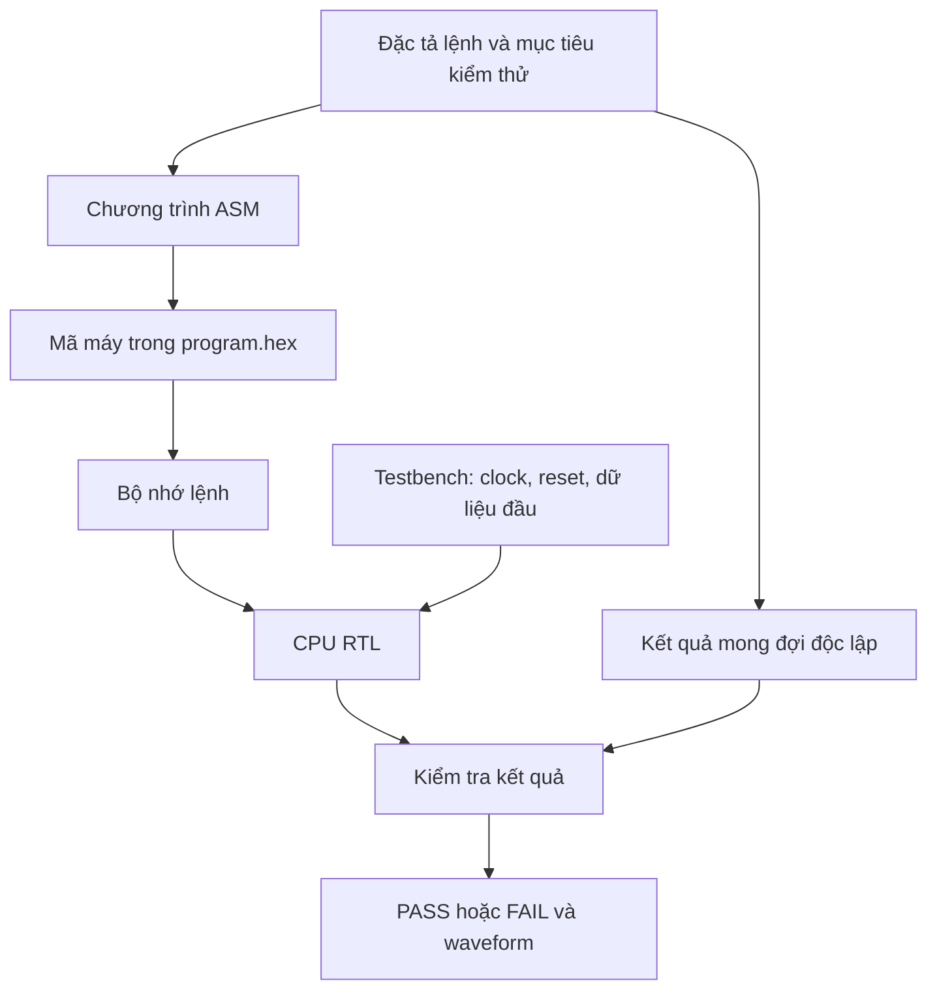

# Hướng dẫn dự án single-cycle ARM processor

Môn: **Thiết kế số và vi xử lý** · Cập nhật: **18/11/2026**

Tài liệu này dùng để tự học, triển khai kiểm thử và làm chỉ dẫn cho những lần hỗ trợ dự án tiếp theo. Các liên kết slide là những tài liệu đã được tìm thấy và đọc; ví dụ mã dưới đây là mẫu hướng dẫn, chưa phải code đã tích hợp vào repo.

## 1. Mục tiêu và phạm vi dự án

Dự án tập trung vào **kiểm chứng CPU ARM Single-Cycle**. Nhóm dùng RTL do giảng viên cung cấp làm thiết kế cần kiểm tra (DUT), phân tích cách CPU hoạt động và tự xây dựng môi trường kiểm chứng bằng SystemVerilog. Đối chiếu với mã trong sách và tài liệu được giao khi xác định giao diện, mã lệnh và quy ước PC. [Đề bài cuối kỳ][de-bai]

- Phạm vi kiểm chứng gồm **ADD, SUB, AND, OR, LD, ST và BEQ**. Kiến thức vấn đáp tập trung vào Chương 5, Chương 6 và Chương 7 đến phần Single-Cycle Processor. Các chương 1–4 trong lộ trình là phần ôn nền.
- Dùng **ModelSim Intel FPGA Starter Edition 10.5b**. Môi trường cần có Driver, Monitor, Reference Model và Scoreboard. UVM là tùy chọn.
- Lập Verification Plan trước khi viết testbench. Chạy test riêng từng lệnh, test reset và chương trình tích hợp đủ 7 lệnh. Báo cáo kết quả bằng log PASS/FAIL, waveform và tổng hợp coverage.
- Nhóm dùng chung môi trường kiểm chứng. Mỗi thành viên chuẩn bị báo cáo cá nhân, giải thích ca kiểm thử mình phụ trách và bằng chứng mô phỏng.

**Tình trạng nhánh `main` ngày 18/11/2026.** Repo hiện có tài liệu đề bài, slide DDCA, sách ARM và hướng dẫn của nhóm. Tên module, cổng và đoạn code bên dưới là ví dụ để đối chiếu khi nhận RTL. [Repo dự án][repo]

## 2. ASM → 32 bit → testbench: hiểu đúng quy trình

Ý tưởng bắt đầu từ ASM rồi đổi sang mã máy 32 bit là đúng. Sau đó cần tách hai việc:

1. **Tạo chương trình kiểm thử:** mã máy được đưa vào instruction memory để CPU đọc và thực thi.
2. **Viết testbench:** tạo clock/reset, chuẩn bị bộ nhớ dữ liệu và kiểm tra kết quả CPU thực hiện chương trình đó.

**Mã máy là dữ liệu đầu vào của CPU. Testbench là môi trường kiểm chứng CPU.** Một chuỗi mã máy tự nó chưa chỉ ra PASS hay FAIL.



Ví dụ: muốn kiểm tra phép cộng `5 + 7`, chương trình tạo hai toán hạng và chạy `ADD`; testbench phải biết trước kết quả cần là **12**. Không lấy chính kết quả ALU của DUT làm giá trị mong đợi, vì như vậy có thể bỏ sót lỗi ALU.

## 3. Các slide cũ cần học và liên kết mở lại

**Cách đọc số trang:** các khoảng dưới đây tính theo thứ tự trang trong bản trích xuất của file. Số in ở chân slide có thể khác, nhất là Chương 2, 5 và 7; hãy dùng thêm tên mục để tìm.

| Thứ tự | Slide đã có | Phần cần đọc | Áp dụng vào CPU/testbench |
|---|---|---|---|
| 1 | [Chương 1 — nền tảng số][ch1] | Trang 12–24: binary, hex, độ rộng, cộng và overflow; 25–37: số có dấu, bù hai, sign/zero extension; 38–43: cổng logic | Đọc dữ liệu 32 bit, hiểu số âm, kiểm tra tràn và mở rộng immediate |
| 2 | [Chương 2 — combinational logic][ch2] | Trang 3–20: mạch tổ hợp, bảng chân trị, biểu thức Boolean; 136–140: mux, decoder; 141–143: độ trễ | Hiểu decoder chọn phép toán và mux chọn đường dữ liệu |
| 3 | [Chương 3 — sequential logic][ch3] | Trang 14–27: DFF, register, enable, reset; 28–42: FSM; 57–63: setup/hold và timing | Hiểu trạng thái CPU, cạnh clock, ghi register và thời điểm kiểm tra |
| 4 | [Chương 4 — SystemVerilog và testbench][ch4] | Trang 3–20: mô tả HDL và tổ hợp; 28–42: `always_ff`, `always_comb`, `=`, `<=`; 49: parameter; **50–62: testbench, tự kiểm tra, testvector** | Viết RTL và TB; học kỹ các trang 54–62 trước khi viết checker |
| 5 | [Chương 5 — digital building blocks][ch5] | Trang 4–26: adder, subtractor, comparator, ALU; 29–43: ALU và flags; 44–47: shifter | Hiểu khối tính toán và phân biệt carry với signed overflow |
| 6 | [Chương 5 — memory, LUT và FPGA][ch5] | Trang 85–101: memory/RAM; 104: ROM bằng HDL; **107–113: logic bằng bộ nhớ/LUT**; **114–116: multi-port memory/register file**; **120–129: FPGA, LE và design flow** | Hiểu instruction/data memory, register file, LUT và quá trình tổng hợp lên FPGA |
| 7 | [Chương 6.1 — instruction set][ch6-1] | Trang 9–25: ADD/SUB, registers, immediate; 26–36: memory, LDR/STR, byte/word, endianness | Đọc ASM và xác định lệnh phải thay đổi trạng thái nào |
| 8 | [Chương 6.2a — logic, điều kiện và branch][ch6-2a] | Trang 3–8: logic/shift; **11–19: NZCV và conditional execution**; **21–24: branch** | Thiết kế kiểm thử flags, điều kiện đúng/sai, nhảy và không nhảy |
| 9 | [Chương 6.3 — instruction encoding][ch6-3] | **Trang 5–17: định dạng và DP immediate**; 18–31: register/shift; 33–46: memory; **48–55: branch, imm24 và cond**; 56–62: giải mã ngược | Đổi ASM thành mã máy; giải thích từng trường bit khi vấn đáp |
| 10 | [Chương 6.4 — addressing modes][ch6-4] | Trang 3–9: register/immediate/base addressing; **11–13: PC-relative và stored program** | Phân biệt địa chỉ, dữ liệu, offset và chương trình nằm trong bộ nhớ |
| 11 | [Chương 7 — microarchitecture, bản (1)][ch7] | **Trang 9–33: state và datapath**; **37–55: decoder/control**; **57–71: conditional logic/flags**; 72–79: ví dụ và mở rộng; 80–85: performance | Nối trực tiếp ASM, trường bit, control signals và các khối CPU |
| Đọc thêm | [Chương 6.2b — high-level constructs và function calls][ch6-2b] | Trang 2–20: if/loop; 22–27: array; 31–58: function, stack | Dùng khi cần chương trình kiểm thử có vòng lặp hoặc đã mở rộng CPU; function call/stack chưa phải ưu tiên của bản cơ sở |

Cũng có [bản Chương 7 không có hậu tố (1)][ch7-alt]. Dùng một bản xuyên suốt khi ghi số trang trong báo cáo.


### Liên kết tài liệu trên GitHub để dùng chung trong nhóm

Các file dưới đây hiện có trong repo chính thức. Khoảng trang ở bảng phía trên dựa trên các bản slide đã đọc; nếu file được thay hoặc sửa, tìm thêm theo tên mục và đối chiếu lại số trang.

| Tài liệu | Liên kết trong repo |
|---|---|
| Chương 1 — nền tảng số | [Mở trên GitHub](https://github.com/SirNotFunny/SystemVerilogSingleCycleARMProcessor/blob/main/DDCAarm_Ch1.pptx) |
| Chương 2 — combinational logic | [Mở trên GitHub](https://github.com/SirNotFunny/SystemVerilogSingleCycleARMProcessor/blob/main/DDCAarm_Ch2.pptx) |
| Chương 3 — sequential logic | [Mở trên GitHub](https://github.com/SirNotFunny/SystemVerilogSingleCycleARMProcessor/blob/main/DDCAarm_Ch3.pptx) |
| Chương 4 — SystemVerilog/testbench | [Mở trên GitHub](https://github.com/SirNotFunny/SystemVerilogSingleCycleARMProcessor/blob/main/DDCAarm_Ch4.pptx) |
| Chương 5 — building blocks, memory, LUT/FPGA | [Mở trên GitHub](https://github.com/SirNotFunny/SystemVerilogSingleCycleARMProcessor/blob/main/DDCAarm_Ch5.pptx) |
| Chương 6.1 — instruction set | [Mở trên GitHub](https://github.com/SirNotFunny/SystemVerilogSingleCycleARMProcessor/blob/main/DDCAarm_Ch6%20-%201%20-%20instruction%20set.pptx) |
| Chương 6.2a — data processing, conditional/branch | [Mở trên GitHub](https://github.com/SirNotFunny/SystemVerilogSingleCycleARMProcessor/blob/main/DDCAarm_Ch6%20-%202a%20-%20data%20processing%20and%20conditional%20and%20branch%20executions.pptx) |
| Chương 6.2b — high-level constructs/function calls | [Mở trên GitHub](https://github.com/SirNotFunny/SystemVerilogSingleCycleARMProcessor/blob/main/DDCAarm_Ch6%20-%202b%20-%20high%20level%20construct%20and%20function%20calls.pptx) |
| Chương 6.3 — encoding 32 bit | [Mở trên GitHub](https://github.com/SirNotFunny/SystemVerilogSingleCycleARMProcessor/blob/main/DDCAarm_Ch6%20-%203%20-%20instruction%20encoding.pptx) |
| Chương 6.4 — addressing modes | [Mở trên GitHub](https://github.com/SirNotFunny/SystemVerilogSingleCycleARMProcessor/blob/main/DDCAarm_Ch6%20-%204%20-%20address%20modes.pptx) |
| Chương 6 — bản tổng hợp | [Mở trên GitHub](https://github.com/SirNotFunny/SystemVerilogSingleCycleARMProcessor/blob/main/DDCAarm_Ch6.pptx) |
| Chương 7 — microarchitecture/single-cycle | [Mở trên GitHub](https://github.com/SirNotFunny/SystemVerilogSingleCycleARMProcessor/blob/main/DDCAarm_Ch7.pptx) |

### Lộ trình học có điểm dừng

| Chặng | Học và làm | Có thể chuyển tiếp khi… |
|---|---|---|
| A | Ch1 → Ch2 → phần DFF/register của Ch3 | Đổi được hex/binary, hiểu mux, phân biệt tổ hợp và tuần tự |
| B | Ch4 → Ch5: ALU, RAM, register file | Viết được một TB nhỏ có expected value và PASS/FAIL |
| C | Ch6.1 → Ch6.2a → Ch6.3 → Ch6.4 | Mã hóa và giải mã được một ADD, một STR và một B |
| D | Ch7, từ datapath đến conditional logic | Theo dấu được một lệnh qua các khối và giải thích control signals |
| E | Chốt tập lệnh → lập bảng testcase → viết chương trình ngắn | Tính được trạng thái mong đợi mà chưa cần chạy DUT |
| F | Viết checker → chạy ModelSim → ghi bằng chứng | Phát hiện được lỗi, báo đúng ca lỗi và giải thích được waveform |

Chưa cần học hết multicycle/pipeline để hoàn thành bản single-cycle. Phần FSM giúp hiểu trạng thái; bản single-cycle cơ sở không cần một FSM điều khiển nhiều chu kỳ để lần lượt chạy fetch/decode/execute.

## 4. “32 bit”, logic và LUT liên quan nhau thế nào?

### 4.1. Phân biệt những đối tượng cùng có thể rộng 32 bit

| Đối tượng | Ví dụ | Ý nghĩa |
|---|---|---|
| Dữ liệu | `32'h0000000C` | Giá trị 12 có thể nằm trong register hoặc RAM |
| Mã lệnh | `32'hE0813002` | Các trường bit yêu cầu thực hiện `ADD R3, R1, R2` |
| Địa chỉ | `32'h00000040` | Vị trí byte 64; nếu RAM tổ chức theo word thì tương ứng phần tử số 16 |
| Bus | `logic [31:0] WriteData` | 32 đường tín hiệu mang một giá trị tại mỗi thời điểm |

Binary và hex là hai cách viết **cùng một mẫu bit**. Một chữ số hex biểu diễn 4 bit; 8 chữ số hex biểu diễn 32 bit. Không phải mọi hằng immediate đều có đủ 32 bit nằm trực tiếp trong lệnh: các bit còn lại phải chứa opcode, số register và các trường điều khiển.

Với dữ liệu bù hai 32 bit:

- Miền unsigned: `0` đến `2^32 - 1`.
- Miền signed: `-2^31` đến `2^31 - 1`.
- `32'hFFFFFFFF` là `4294967295` nếu đọc unsigned, và `-1` nếu đọc signed.
- `32'h7FFFFFFF + 1 = 32'h80000000`: tràn signed, chưa có carry ra bit 32.
- `32'hFFFFFFFF + 1 = 32'h00000000`: có carry, không tràn signed khi hiểu phép cộng là `-1 + 1`.

### 4.2. LUT không phải bảng đổi ASM sang binary

Một **look-up table** có thể lưu đầu ra cho mỗi tổ hợp đầu vào của hàm logic. Ví dụ `Y = A & B`:

| A | B | Y |
|---|---|---|
| 0 | 0 | 0 |
| 0 | 1 | 0 |
| 1 | 0 | 0 |
| 1 | 1 | 1 |

Nếu coi `{A,B}` là địa chỉ 0–3, bốn bit lưu tương ứng là `0,0,0,1`. Trong mô hình khái niệm `Y = table[{A,B}]`, có thể viết `table = 4'b1000`. Đây là cách giải thích logic, chưa phải cách ghi bitstream cụ thể của nhà sản xuất.

Trong FPGA, công cụ tổng hợp ánh xạ nhiều hàm tổ hợp vào LUT và dùng flip-flop để lưu trạng thái. **Một ALU 32 bit được tạo bởi nhiều tài nguyên logic**, không phải một LUT nhỏ chứa mọi phép toán 32 bit. Nếu triển khai trên MAX 10/DE10-Lite, tài liệu chính thức mô tả LE có LUT 4 đầu vào, register và carry chain; xem [tài liệu MAX 10][max10].

Phân biệt ba loại “bảng” thường gặp:

| Bảng | Dùng ở đâu? | Dùng để làm gì? |
|---|---|---|
| Bảng encoding | Khi viết/đọc mã máy | Xác định bit nào biểu diễn lệnh, register, immediate |
| Bảng điều khiển | Khi thiết kế controller | Từ trường lệnh sinh `RegWrite`, `ALUSrc`, `MemWrite`… |
| LUT của FPGA | Khi ánh xạ RTL lên phần cứng | Thực hiện các hàm logic bằng tài nguyên cấu hình được |

## 5. Các thành phần CPU cần hiểu

| Khối | Nhiệm vụ | Điều cần giải thích hoặc kiểm tra |
|---|---|---|
| PC register | Giữ địa chỉ lệnh hiện tại | Reset về đâu? Khi nào tăng 4? Khi nào nhận địa chỉ nhảy? |
| Instruction memory | Từ PC đọc ra mã lệnh | Chỉ số mảng là byte hay word? Đọc tổ hợp hay có trễ clock? |
| Register file | Đọc toán hạng, ghi kết quả | Địa chỉ register thường 4 bit; dữ liệu 32 bit; read/write ở thời điểm nào? |
| Immediate extender | Tạo toán hạng 32 bit từ trường immediate | DP dùng imm8; memory dùng imm12; branch dùng imm24 có dấu và dịch 2 bit trong bản cơ sở |
| ALU | ADD, SUB, AND, ORR | Phép toán, thứ tự toán hạng, kết quả và NZCV |
| Data memory | Thực hiện load/store | `address = base + offset`; STR ghi giá trị nào? LDR ghi về register nào? |
| Multiplexers | Chọn nguồn dữ liệu | Register/immediate, ALU/memory, PC+4/branch target |
| Decoder/controller | Giải mã các trường lệnh | Tín hiệu nào được bật cho từng loại lệnh? |
| Condition/flags logic | Quyết định lệnh có hiệu lực và cập nhật flags | Điều kiện sai phải chặn các tác động ghi; flags được giữ hay cập nhật? |

Nối với các bài lab đã học: **mux/ALU → datapath; DFF có reset/enable → PC và register; RAM → data memory; FSM → tư duy trạng thái và clock**. Đây là liên hệ khái niệm; vẫn cần đối chiếu độ rộng và giao diện khi dùng lại module.

**Single-cycle:** giữa hai cạnh clock liên tiếp, các khối tổ hợp đọc/giải mã/tính toán; tại cạnh chốt, các phần tử trạng thái nhận kết quả. Các bước mô tả một lệnh không có nghĩa mỗi bước chiếm một chu kỳ riêng.

`PC + 4` là địa chỉ lệnh tuần tự kế tiếp đối với chuỗi A32 trong mô hình này. Giá trị đọc kiến trúc của R15 và cơ sở tính branch là `PC + 8` theo thiết kế ARM đang học. Hai giá trị có mục đích khác nhau, cần theo đúng Ch7 và RTL thực tế.

## 6. Tập lệnh cần kiểm chứng

| Nhóm | Lệnh theo đề | Cần xác nhận trong RTL được giao |
|---|---|---|
| Data processing | `ADD`, `SUB`, `AND`, `OR` | Opcode, dạng toán hạng, thanh ghi đích và cách cập nhật flags nếu có |
| Memory | `LD`, `ST` | Địa chỉ hiệu dụng, cách đọc/ghi bộ nhớ, dữ liệu và đường ghi về thanh ghi |
| Branch | `BEQ` | Cách xác định hai toán hạng bằng nhau, cách tính đích và PC khi nhảy hoặc đi tiếp |

Các ví dụ ở dưới dùng cú pháp ARM A32 trong sách, với tên `ORR`, `LDR`, `STR` và mã hóa nhánh của [Chương 7][ch7]. Dùng tên, định dạng mã máy và cơ chế so sánh theo DUT khi tạo test thực tế. Ca `BEQ` cần có hai toán hạng bằng nhau và khác nhau. Nếu DUT dùng cờ `Z`, thiết lập cờ bằng chuỗi lệnh mà DUT hỗ trợ.

Chương 7 minh họa immediate của data processing bằng cách zero-extend imm8. Chương 6.3 có thêm encoding A32 xoay imm8. Chọn dạng toán hạng theo RTL khi mã hóa chương trình. `MOV`, `CMP`, `BNE`, `BL` và các dạng shift là nội dung tham khảo. Chỉ đưa chúng vào chương trình kiểm thử khi DUT hỗ trợ.

## 7. Ví dụ đầy đủ: một lệnh ASM thành 32 bit

Giả sử trước lệnh: `R1 = 5`, `R2 = 7`.

```asm
ADD R3, R1, R2
```

Kết quả kiến trúc cần có: `R3 = 12`, PC chuyển tới lệnh tuần tự tiếp theo; S-bit bằng 0 nên status flags được giữ nguyên.

| Trường | Bit | Giá trị | Ý nghĩa |
|---|---|---|---|
| cond | 31:28 | `1110` | AL, thực hiện vô điều kiện |
| op | 27:26 | `00` | Data processing |
| I | 25 | `0` | Src2 từ register |
| opcode/cmd | 24:21 | `0100` | ADD |
| S | 20 | `0` | Không cập nhật status flags |
| Rn | 19:16 | `0001` | R1 |
| Rd | 15:12 | `0011` | R3 |
| Shift fields | 11:4 | `00000000` | Không dịch |
| Rm | 3:0 | `0010` | R2 |

Ghép thành cùng một mã lệnh ở hai cách viết:

```systemverilog
32'b1110_0000_1000_0001_0011_0000_0000_0010
32'hE0813002
```

Khi giải thích datapath: register file đọc R1/R2 → mux chọn dữ liệu register → ALU cộng → mux writeback chọn ALUResult → ghi R3. Trong quy ước Ch7: `ALUSrc = 0`, `ALUControl = 00`, `RegWrite = 1`, `MemWrite = 0`, `MemtoReg = 0`, `PCSrc = 0`. Tên và mã hóa tín hiệu cần đối chiếu với code nhóm.

### Branch: công thức cần nhớ

Trong ví dụ A32 ở Chương 7, gọi `A` là địa chỉ byte của chính lệnh nhánh và `T` là địa chỉ đích. Khi DUT dùng encoding nhánh A32 với `imm24`, tính như sau.

```text
imm24_signed = (T - (A + 8)) / 4
T = A + 8 + sign_extend(imm24 << 2)
```

Đích cần word-aligned và offset cần nằm trong miền biểu diễn có dấu. Khi viết RTL cho toán hạng 32 bit, có thể biểu diễn phần offset là `{{6{Instr[23]}}, Instr[23:0], 2'b00}`.

Ví dụ `B` về chính nó: `(A - (A + 8))/4 = -2`; trường imm24 là `0xFFFFFE`, cả lệnh AL là `0xEAFFFFFE`. Đây là vòng lặp vô hạn của chương trình; testbench vẫn phải có timeout hoặc điều kiện kết thúc.

## 8. Tạo chương trình kiểm thử ngắn

Ví dụ sau kiểm tra đường đi **khởi tạo → ADD → STR → LDR → STR**. Giả định CPU đọc R15 theo `PC + 8`, instruction/data memory là các mảng word và PC bắt đầu ở 0.

| Địa chỉ byte | ASM | Mã máy 32 bit | Kết quả mong đợi sau khi hoàn tất lệnh |
|---|---|---|---|
| `0x00` | `SUB R0, R15, R15` | `E04F000F` | R0 = 0, không phụ thuộc giá trị ban đầu của các register thông thường |
| `0x04` | `ADD R1, R0, #5` | `E2801005` | R1 = 5 |
| `0x08` | `ADD R2, R0, #7` | `E2802007` | R2 = 7 |
| `0x0C` | `ADD R3, R1, R2` | `E0813002` | R3 = 12 |
| `0x10` | `STR R3, [R0, #64]` | `E5803040` | RAM tại địa chỉ byte 64 nhận 12 |
| `0x14` | `LDR R4, [R0, #64]` | `E5904040` | R4 = 12 |
| `0x18` | `STR R4, [R0, #68]` | `E5804044` | RAM tại địa chỉ byte 68 nhận 12 |
| `0x1C` | `B` về chính lệnh tại `0x1C` | `EAFFFFFE` | Giữ chương trình trong vùng hợp lệ nếu tiếp tục chạy |

Nội dung `program.hex`, mỗi dòng là một word lệnh:

```text
E04F000F
E2801005
E2802007
E0813002
E5803040
E5904040
E5804044
EAFFFFFE
```

Nếu chạy từ thư mục gốc của gói nộp theo mục 11, đặt file trong `testbench/` và nạp bằng `$readmemh("testbench/program.hex", imem, 0, 7)`. Trong file dữ liệu này chỉ cần các chữ số hex; không viết tiền tố `32'h` như hằng trong source SystemVerilog. Nếu dùng chuỗi 32 ký tự `0/1` cho mỗi word thì dùng `$readmemb`.

**Byte và word:** `PC = 0x0C` đọc `imem[3]`; địa chỉ data `0x40` ứng với `dmem[16]`. Với mảng word 32 bit và địa chỉ word-aligned, chỉ số là `address[31:2]`. Mỗi dòng trên là cả một word lệnh, không phải từng byte theo thứ tự little-endian.

Có thể mã hóa thủ công vài lệnh đại diện để học và đối chiếu. Khi dùng assembler cho nhiều lệnh, chọn encoding **A32** phù hợp, kiểm tra disassembly và tập lệnh hỗ trợ; một công cụ chuyển đổi không thay cho việc kiểm tra CPU có thực thi dạng lệnh đó hay không.

## 9. Testbench tự kiểm tra: cấu trúc mẫu

| Thành phần | Việc cần làm |
|---|---|
| Driver | Tạo clock/reset, nạp mã lệnh và dữ liệu đầu vào theo giao diện DUT. |
| Monitor | Ghi nhận PC, mã lệnh, kết quả ALU, ghi thanh ghi, truy cập bộ nhớ và kết quả nhánh tại thời điểm cập nhật tương ứng. |
| Reference Model | Tính PC, nội dung thanh ghi và bộ nhớ kỳ vọng từ chương trình, trạng thái đầu và đặc tả 7 lệnh. |
| Scoreboard | So sánh trạng thái kỳ vọng với dữ liệu Monitor quan sát được. Tự báo PASS/FAIL và ghi ca kiểm thử, giá trị kỳ vọng và giá trị thực tế khi có sai khác. |

Đoạn code dưới đây minh họa một ca tự kiểm tra bằng hai lần ghi RAM. Dùng các thành phần trong bảng để mở rộng thành môi trường nộp bài.

### Giao diện giả định

Ví dụ dùng một core tên `arm` với các cổng `clk`, `reset`, `PC`, `Instr`, `MemWrite`, `ALUResult`, `WriteData`, `ReadData`. Đây là **hợp đồng giao diện mẫu**, chưa được xác nhận trong repo. Nếu top-level của nhóm đã chứa instruction/data memory thì dùng bộ nhớ sẵn có và sửa cách nạp/quan sát, tránh tạo thêm bản sao bộ nhớ bên ngoài.

Mẫu dùng instruction memory/data read tổ hợp và data write ở cạnh lên, phù hợp giả định single-cycle đang học.

```systemverilog
`timescale 1ns/1ps
module cpu_tb;
  logic clk = 0, reset = 1;
  logic [31:0] PC, Instr, ALUResult, WriteData, ReadData;
  logic MemWrite;
  logic [31:0] imem [0:63], dmem [0:63];
  int stores = 0;

  arm dut (.clk(clk), .reset(reset), .PC(PC), .Instr(Instr),
           .MemWrite(MemWrite), .ALUResult(ALUResult),
           .WriteData(WriteData), .ReadData(ReadData));

  always #5 clk = ~clk;
  assign Instr = imem[PC[31:2]];
  assign ReadData = dmem[ALUResult[31:2]];

  initial begin
    for (int i = 0; i < 64; i++) begin
      imem[i] = 32'hEAFFFFFE;
      dmem[i] = 0;
    end
    $readmemh("testbench/program.hex", imem, 0, 7);
    repeat (2) @(negedge clk);
    reset = 0;

    repeat (20) begin
      @(posedge clk); #1;
      if (stores == 2) begin
        if (dmem[16] !== 32'd12 || dmem[17] !== 32'd12)
          $fatal(1, "FAIL: committed memory result");
        $display("PASS: ADD/STR/LDR example");
        $finish;
      end
    end
    $fatal(1, "FAIL: timeout, stores=%0d", stores);
  end

  always @(posedge clk) begin
    if (!reset) begin
      if (MemWrite !== 1'b0 && MemWrite !== 1'b1)
        $fatal(1, "FAIL: unknown MemWrite");
      if (MemWrite) begin
        if (stores >= 2)
          $fatal(1, "FAIL: unexpected extra store");
        if (ALUResult !== (32'd64 + 4*stores) || WriteData !== 32'd12)
          $fatal(1, "FAIL: store %0d addr=%h data=%h",
                 stores, ALUResult, WriteData);
        dmem[ALUResult[31:2]] <= WriteData;
        stores = stores + 1;
      end
    end
  end
endmodule
```

**Cách đọc:** checker quan sát giao dịch store tại cạnh lên, trước khi PC/register thay đổi bởi nonblocking assignments. Kiểm tra nội dung RAM sau `#1` để chờ cập nhật NBA. Không chèn cùng độ trễ đó vào monitor store rồi vô tình đọc bus của lệnh kế tiếp.

`!==` giúp coi cả X/Z là sai so với một expected value xác định. Testbench đổi reset ở cạnh xuống để tránh tranh chấp với logic chốt cạnh lên. Chu kỳ 10 ns ở đây là lựa chọn mô phỏng chức năng, chưa chứng minh CPU chạy được 100 MHz trên FPGA.

Mẫu chỉ kiểm tra chuỗi ADD/STR/LDR này, có giới hạn 20 chu kỳ sau reset. Nó kết thúc sau store thứ hai, **chưa kiểm chứng lệnh B ở cuối**, chưa kiểm thử flags, reset giữa chương trình hay mọi lỗi có thể xảy ra. Muốn quan sát từng register ngay sau mỗi lệnh, bổ sung một giao diện debug hoặc checkpoint đọc register phù hợp với thiết kế; số 12 ở đầu ra chỉ chứng minh các tác động được checker này quan sát.

## 10. Verification Plan và phân công

Mỗi test case cần ghi mục tiêu, trạng thái đầu và dữ liệu đầu vào, chuỗi lệnh, kết quả kỳ vọng, tín hiệu cần quan sát và tiêu chí PASS/FAIL. Tính kết quả kỳ vọng từ đặc tả, rồi dùng Scoreboard so sánh với DUT.

| Nhóm test | Ca cần có | Kết quả kiểm tra |
|---|---|---|
| `ADD`, `SUB` | Toán hạng bằng 0, hai toán hạng bằng nhau, số dương và âm theo biểu diễn của DUT, giá trị biên | Kết quả số học và thanh ghi đích đúng |
| `AND`, `OR` | Mẫu toàn 0, toàn 1, bit xen kẽ và trường hợp chỉ một toán hạng có bit 1 | Kết quả từng bit và thanh ghi đích đúng |
| `LD` | Đọc ít nhất hai địa chỉ hợp lệ, dùng dữ liệu 0 và các mẫu bit khác nhau | Địa chỉ đọc, dữ liệu và thanh ghi nhận đúng |
| `ST` | Ghi nhiều giá trị vào các địa chỉ, ghi đè và đọc lại | `MemWrite`, địa chỉ, dữ liệu ghi và nội dung bộ nhớ đúng |
| `BEQ` | Một ca hai toán hạng bằng nhau (taken), một ca khác nhau (not-taken). Chọn địa chỉ đích khác địa chỉ lệnh kế tiếp để phân biệt hai đường đi | Quan sát kết quả nhánh và so sánh PC sau lệnh với đích hoặc địa chỉ tuần tự theo DUT |
| Tích hợp | Một chương trình dùng đủ 7 lệnh, lệnh sau dùng kết quả lệnh trước, có `LD`, `ST` và `BEQ` | Trạng thái cuối khớp Reference Model |
| Reset và chạy tuần tự | Reset khởi động, chạy nhiều lệnh, reset rồi khởi tạo và chạy lại | Trạng thái reset và thứ tự cập nhật đúng theo đặc tả |

Tổng hợp coverage từ các ca đã chạy. Ghi đủ 7/7 lệnh, hai kết quả nhánh, địa chỉ và mẫu dữ liệu bộ nhớ, các nhóm toán hạng và chương trình tích hợp. Dẫn log hoặc waveform làm bằng chứng.

Nếu DUT có S-bit hoặc cơ chế thực thi có điều kiện của A32, có thể bổ sung ca cập nhật và giữ nguyên flags, nhánh lùi với offset âm và chặn ghi khi điều kiện sai. Các tình huống này phụ thuộc phạm vi RTL được giao.

### Phân chia cho 3 thành viên

| Thành viên | Ca kiểm thử phụ trách | Vai trò dùng chung đề xuất |
|---|---|---|
| Dũng | `ADD`, `SUB`, `AND`, `OR`; giải thích ALU, chọn toán hạng và ghi thanh ghi | Phụ trách Reference Model. Thống nhất cách mô hình hóa memory và PC cùng Đạt và Khánh. |
| Đạt | `LD`, `ST`; giải thích tính địa chỉ, ghi/đọc bộ nhớ và ghi về thanh ghi | Phụ trách Driver và Monitor. |
| Khánh | `BEQ` taken/not-taken và giá trị PC tiếp theo; giải thích điều kiện nhánh và cách tính đích theo DUT | Phụ trách Scoreboard và tổng hợp coverage từ kết quả của cả nhóm. |

Cả nhóm thống nhất giao diện, Verification Plan, ca reset, chương trình tích hợp và chạy thử gói nộp. Mỗi thành viên ghi trong báo cáo ca mình phụ trách, giá trị kỳ vọng và kết quả quan sát được.

## 11. Đóng gói và chạy ModelSim

Nộp **một file nén** ZIP hoặc RAR, đặt tên theo mẫu `CLASS.TEAM`. Ví dụ tên ZIP là `CLASS_TKS10.TEAM5.zip`.

```text
project/            RTL của CPU và danh sách file biên dịch nếu dùng
testbench/          Driver, Monitor, Reference Model, Scoreboard và testbench top
  program.hex      Vị trí file mã máy của ví dụ ở mục 9
  tests/            Chương trình kiểm thử và Verification Plan
  results/          Log PASS/FAIL, waveform tiêu biểu và coverage summary
run.do
HọTênSV.pdf
```

Đặt tên báo cáo PDF theo họ tên sinh viên, chẳng hạn `NguyenVanA.pdf`. Hướng dẫn nộp chấp nhận `run.do` hoặc `run.txt`. Dùng `run.do` để giảng viên có thể chạy trực tiếp và đáp ứng yêu cầu file mô phỏng `.do` trong đề.

Trong ModelSim 10.5b, chọn thư mục đã giải nén chứa `run.do` làm thư mục làm việc, rồi chạy `do run.do` trong Transcript. Ví dụ dưới đây dùng giao diện mẫu ở mục 9 và đường dẫn tương đối từ thư mục đó.

```tcl
if {![file isdirectory work]} {
    vlib work
}
vmap work work
vlog -sv -f project/rtl.f testbench/cpu_tb.sv
vsim -voptargs=+acc work.cpu_tb
add wave sim:/cpu_tb/clk sim:/cpu_tb/reset
add wave sim:/cpu_tb/PC sim:/cpu_tb/Instr
add wave sim:/cpu_tb/MemWrite sim:/cpu_tb/ALUResult
add wave sim:/cpu_tb/WriteData sim:/cpu_tb/ReadData
run -all
```

Trong `project/rtl.f`, liệt kê các file RTL thật bằng đường dẫn tương đối từ thư mục gốc của gói nộp. Nếu có package hoặc nhiều file testbench, thêm các file theo thứ tự phụ thuộc và sửa tên top cho khớp RTL và testbench. Mẫu mục 9 đọc `testbench/program.hex`. Khi đóng gói, chạy thử từ bản giải nén để kiểm tra script, dữ liệu kiểm thử và cách lấy log.

## 12. Ghi báo cáo và chuẩn bị vấn đáp

Mỗi testcase nên có một dòng hồ sơ:

| ID | Mục tiêu | Trạng thái đầu | ASM/hex | Expected | Kết quả thực tế | Bằng chứng |
|---|---|---|---|---|---|---|
| Ví dụ D1 | ADD register | R1=5, R2=7 | `ADD R3,R1,R2` / `E0813002` | R3=12; flags giữ nguyên | Điền sau khi chạy | Log/checkpoint và waveform cần thiết |

Báo cáo cần giải thích tập lệnh, datapath, controller, luồng thực thi và cách các thành phần kiểm chứng phối hợp. Trình bày Test Plan, kết quả mô phỏng, coverage, lỗi phát hiện, cách debug, giới hạn và hướng cải tiến. Chọn waveform tiêu biểu và ghi rõ mỗi hình chứng minh ca nào.

Tự trả lời được các câu hỏi sau:

1. Vì sao cùng 32 bit nhưng instruction và data được hiểu khác nhau?
2. Lấy các trường Rn, Rd, Rm, opcode và cond ở đâu trong lệnh ví dụ?
3. Vì sao ADD register và ADD immediate dùng chung ALU nhưng khác lựa chọn mux?
4. STR lấy register dữ liệu từ trường nào, và khác register base thế nào?
5. Vì sao địa chỉ byte 64 lại là phần tử RAM số 16?
6. PC+4 và PC+8 được dùng ở đâu? Tính một branch tiến/lùi như thế nào?
7. Flags nào đổi khi S=1? Điều kiện sai thì các tác động ghi bị chặn ra sao?
8. Vì sao quan sát bus tại cạnh clock khác với đọc register ngay sau cập nhật NBA?
9. Testbench này phát hiện những lỗi gì, và còn bỏ sót những gì?
10. Nếu RAM đọc có trễ một chu kỳ thì thiết kế single-cycle phải xem xét lại phần nào?

## 13. Chỉ dẫn cho những lần hỗ trợ dự án tiếp theo

- Dùng bảy lệnh trong đề làm phạm vi kiểm chứng. Đối chiếu RTL được giao để xác nhận mã hóa, cú pháp, giao diện, thời điểm quan sát và quy ước PC.
- Khi cần học lại kiến thức, liên kết đúng slide ở mục 3, chỉ rõ phần liên quan và giải thích bằng một ví dụ nhỏ.
- Trình bày một lệnh theo thứ tự: **ASM → trạng thái mong đợi → trường bit → control signals → datapath → điểm kiểm tra trong TB**.
- Với mỗi testcase, giải thích lý do chọn dữ liệu và lỗi mà ca đó có thể phát hiện. Kết quả mong đợi phải tính độc lập từ ý nghĩa lệnh.
- Ưu tiên TB tự kiểm tra, dùng lại helper khi có nhiều ca, có thông báo lỗi rõ và giới hạn thời gian. Tránh thêm framework phức tạp khi bài tập chưa cần.
- Chỉ dùng đường dẫn hierarchy và tên module đã xác minh. Với ví dụ giả định, ghi rõ giao diện và các chỗ cần sửa.
- Phân biệt test ở cấp khối, cấp CPU và kiểm tra trên FPGA; phân biệt bus đang thực hiện giao dịch với trạng thái đã được chốt.
- Giữ phạm vi kiểm thử giữa các thành viên rõ ràng, đồng thời cho phép các lệnh phụ trợ dùng chung. Tình huống liên nhóm chức năng có thể cần thiết để kiểm tra tương tác.
- Báo cáo/testbench của mỗi nhóm cần có tình huống và lập luận riêng; giải thích sự khác biệt bằng mục tiêu kiểm thử thực tế.
- Luôn hướng tới việc người viết tự giải thích được báo cáo và TB khi vấn đáp. Không ghi kết quả PASS, khả năng chạy ModelSim hay khả năng chạy FPGA nếu chưa có bằng chứng thực thi tương ứng.

## 14. Tài liệu tham khảo bổ sung

Đối chiếu [đề bài cuối kỳ][de-bai] và các slide môn học ở mục 3. Tài liệu đọc thêm gồm:

- [Trang tài nguyên DDCA ARM của tác giả][ddca]: có các gói lecture slides, HDL và labs. Dùng làm tài liệu tham khảo và đối chiếu, kiểm tra với phiên bản môn học trước khi áp dụng.
- [Arm — ADD/ADDS immediate, encoding A32][arm-add]: đối chiếu trường bit; chọn phần A32/A1 của tài liệu.
- [Arm — giải thích hằng immediate][arm-imm]: lý do cần imm8 và rotation trong encoding A32.
- [MAX 10 — Logic Elements][max10]: đối chiếu LUT, register và carry chain của FPGA.
- [Altera — compile SystemVerilog bằng vlog][sim-compile]: tham khảo lệnh `vlog -sv` và logical library. Tài liệu này thuộc Questa đời mới; ví dụ ModelSim ở mục 11 cần phù hợp bản cài và project thực tế.
- [Ghi nhớ yêu cầu dự án][project-note]: các yêu cầu đã ghi lại trước tài liệu này.

**Giới hạn xác minh:** đã đọc các slide được dẫn và kiểm tra trạng thái repo. Các word mã máy và trạng thái số học trong ví dụ được đối chiếu bằng tính toán. Mẫu TB còn cần core đúng giao diện để biên dịch và chạy; tài liệu không coi ví dụ đó là kết quả ModelSim đã chạy thành công.

[de-bai]: Project_Cuoi_Ky_Thiet_Ke_So_Va_Vi_Xu_Ly_ARM.pdf
[repo]: https://github.com/SirNotFunny/SystemVerilogSingleCycleARMProcessor
[ch1]: https://chatgpt.com/library?file_id=libfile_ba2b58abc4508191a7323022ead5c66e&account_id=personal
[ch2]: https://chatgpt.com/library?file_id=libfile_ec56d95f1f988191abedddc25a7e74d1&account_id=personal
[ch3]: https://chatgpt.com/library?file_id=libfile_8064a01ce7e48191a9c4260df5c3615b&account_id=personal
[ch4]: https://chatgpt.com/library?file_id=libfile_0a9fbd347dc8819195bb6c2e025a073d&account_id=personal
[ch5]: https://chatgpt.com/library?file_id=libfile_e69299a52cc48191a4b9f7332bd97c9c&account_id=personal
[ch6-1]: https://chatgpt.com/library?file_id=libfile_13ba0e2ae0f08191a80fd66a6c8b3ae2&account_id=personal
[ch6-2a]: https://chatgpt.com/library?file_id=libfile_20d8cef6871881918edb217cd3e0d6bf&account_id=personal
[ch6-2b]: https://chatgpt.com/library?file_id=libfile_b43a4728fb70819186e0fd67514e17b1&account_id=personal
[ch6-3]: https://chatgpt.com/library?file_id=libfile_1515087b3a3c819192db0e3d837bf654&account_id=personal
[ch6-4]: https://chatgpt.com/library?file_id=libfile_46238e3ecc1c8191bbfad4c52614d5e5&account_id=personal
[ch7]: https://chatgpt.com/library?file_id=libfile_d70f97a99cc88191aaffab8cf1c14807&account_id=personal
[ch7-alt]: https://chatgpt.com/library?file_id=libfile_66aba5fc7bd08191b7d4c9a49eda9aae&account_id=personal
[project-note]: https://chatgpt.com/library?file_id=libfile_ee1284d0b5748191ae3e14b3bb943da9&account_id=personal
[ddca]: https://pages.hmc.edu/harris/ddca/ddcaarm.html
[arm-add]: https://support.arm.com/documentation/ddi0597/2024-12/Base-Instructions/ADD--ADDS--immediate---Add--immediate--
[arm-imm]: https://developer.arm.com/community/arm-community-blogs/b/architectures-and-processors-blog/posts/how-to-load-constants-in-assembly-for-arm-architecture
[max10]: https://docs.altera.com/r/docs/683105/current/max-10-fpga-device-architecture/logic-elements?contentId=SXR~HZXMeI2fpXAf~h_cVg
[sim-compile]: https://docs.altera.com/r/docs/730191/26.1/questa-altera-fpga-edition-simulation-user-guide/compilation-example-1-compile-file-foo.sv-into-a-logical-library?contentId=jf34mPOnz9gQSO2aG7FdCA
